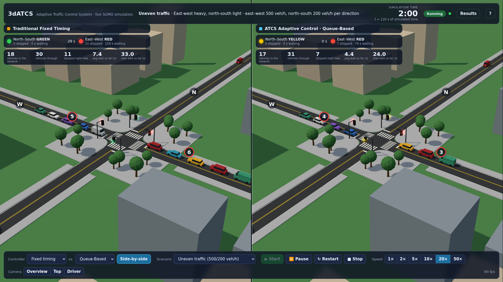
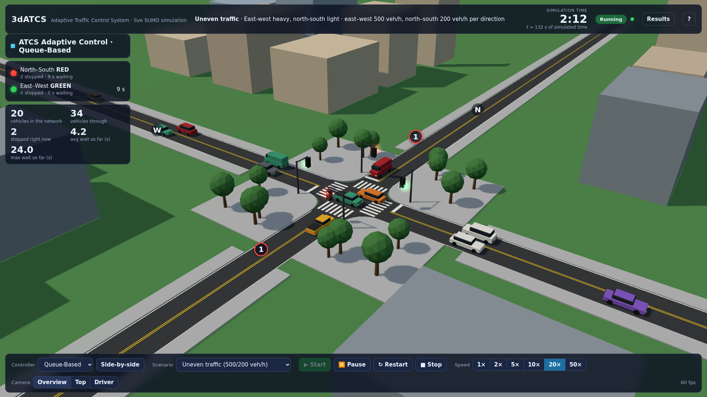
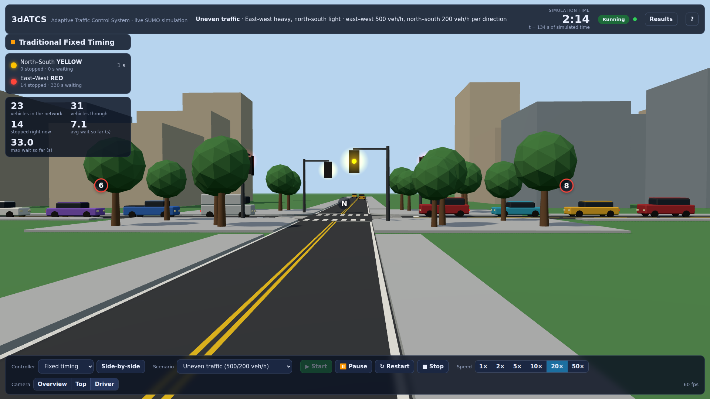

# 3dATCS — ATCS in 3D

A real-time 3D view of the **Adaptive Traffic Control System (ATCS)** controllers, built for Holberton Demo Day.

Every car and every traffic light you see comes from a real **SUMO** simulation that is steered by the **unmodified ATCS
controllers** (Fixed, Queue-Based, Wait-Time). The 3D page only draws what SUMO reports; it makes no traffic decisions.



| | |
|---|---|
|  |  |

> **What the numbers mean.** All comparisons are *SUMO simulation results* for the ATCS test scenarios, not real-world
> traffic measurements.

## What it shows

- A four-way signalised intersection (the ATCS SUMO network), with lane markings, crosswalks, sidewalks, signal masts and
  surrounding blocks. The road geometry is generated from the same `.net.xml` SUMO simulates.
- Vehicles that are real SUMO vehicles (same ids, positions, headings), queues forming at red and clearing on green.
- Signal heads driven by SUMO's signal state, plus a live panel with the numbers the controllers themselves use
  (stopped vehicles and accumulated waiting time per direction).
- **Fixed vs. adaptive**: choose Fixed, Queue-Based or Wait-Time, or run **Fixed and an ATCS controller side by side**
  on identical demand.
- **Measured results**: a full simulated hour per controller (average/maximum waiting time, time loss, vehicles
  completed, % improvement versus Fixed) from headless SUMO runs, plus the numbers of the run you just watched.

## Architecture in one picture

```
 ATCS controllers ──► SUMO + TraCI ──► State bridge ──────────► 3D renderer (browser)
 (unmodified Python)   (authoritative   sim_worker → session →    Three.js: draws state,
                        simulation)      WebSocket JSON frames     smooths between frames
```

Details in [ARCHITECTURE.md](ARCHITECTURE.md). Why Three.js and not Unity/Godot: [RESEARCH.md](RESEARCH.md).

## Requirements

- Linux or WSL2 (developed on Windows 11 + WSL Ubuntu 24.04, NVIDIA RTX GPU)
- **SUMO 1.18+** with its Python tools (`traci`, `sumolib`) — e.g. `sudo apt install sumo sumo-tools`
- Python 3.10+ (3.12 tested)
- A modern browser (Chrome / Edge) — on Windows you can use the Windows browser against the WSL server.

Nothing is installed system-wide: `setup.sh` creates a project-local `.venv`. three.js is vendored in
`web/vendor/`, so the demo runs **offline**.

## Setup

```bash
cd ~/3dATCS
./setup.sh          # creates .venv, installs aiohttp (+ pytest/playwright for the tests), runs a self-check through SUMO
```

## Launch

```bash
./run.sh                    # then open http://localhost:8765 in a browser
./run.sh --port 9000        # another port
./run.sh --host 0.0.0.0     # let another PC on the network (e.g. a projector laptop) connect
```

From Windows, open `http://localhost:8765` in Chrome/Edge (WSL2 forwards localhost).

Other commands:

```bash
./run.sh benchmark --all    # headless full hour for all controllers x all scenarios → results/benchmark_*.json
./run.sh install-browser    # only for the tests/video/screenshots: a project-local Chromium (the demo itself needs none)
./run.sh test -m "not slow" # test-suite without the one-minute full-hour tests
./run.sh record             # record a backup demo video from the running server (output/backup_demo.webm)
```

## Using it

| Control | What it does |
|---|---|
| **Controller** | Fixed timing · Queue-Based · Wait-Time. Choosing another controller during a run ends that run and starts a **fresh** one with the same scenario (nothing is switched silently mid-run). |
| **Side-by-side** | Fixed on the left, an ATCS controller on the right: two independent SUMO instances stepped in lockstep. |
| **Scenario** | The four ATCS scenarios (uneven, balanced, north-south heavy, rush hour). Demand and seed are identical for every controller. |
| **Start / Pause / Resume / Restart / Stop** | `Space` toggles start/pause/resume. Pause freezes the simulation clock itself. |
| **Speed** | 1×, 2×, 5×, 10×, 20×, 50× simulated seconds per real second (50× plays the whole hour in ~75 s). |
| **Camera** | Mouse: drag = orbit, right-drag = pan, wheel = zoom. Buttons/keys: Overview (`O`), Top (`T`), Driver (`D`). |
| **Results** (`P`) | Measured comparison table; opens by itself when a run finishes. |
| `H` | Hide the interface for a clean projector view. `?` lists all shortcuts. |

The step-by-step presentation script is in [DEMO_DAY.md](DEMO_DAY.md).

## Headline results (SUMO, one simulated hour, seed 23423)

| Scenario (EW / NS veh/h) | Fixed avg wait | Queue-Based | Wait-Time |
|---|---:|---:|---:|
| Uneven (500 / 200) | 13.39 s | 6.07 s (−54.7%) | 6.18 s (−53.9%) |
| Balanced (300 / 300) | 13.37 s | 6.21 s (−53.5%) | 5.11 s (−61.8%) |
| North-south heavy (200 / 600) | 14.80 s | 6.01 s (−59.4%) | 6.50 s (−56.1%) |
| **Rush hour (900 / 700)** | 18.06 s | **18.26 s (+1.1%)** | **19.48 s (+7.9%)** |

In saturated rush-hour traffic the adaptive controllers are **not** better on average waiting time (they do reduce the
worst-case wait). That is the ATCS project's own documented finding and it is reproduced here — see
[VALIDATION.md](VALIDATION.md) for the full tables, the evidence, and what we observed about how the controllers behave.

## Known limitations

- The ATCS scenarios contain only straight-through traffic on a single-lane-per-direction intersection, so you will not
  see turning vehicles or pedestrians in the demo. The crosswalks are decoration (SUMO has no pedestrians here).
  Turning vehicles *are* handled by the bridge (tested with diagnostic demand) but turning has not been exercised in the
  browser.
- SUMO runs at its default 1 s step (the step the controllers were tuned for). The smooth motion on screen is interpolation
  between those 1 Hz snapshots, delayed by one step; at the end of every interpolation the car is exactly where SUMO put it.
- Frame rates in `VALIDATION.md` were measured in headless Chromium on WSL (real GPU via Mesa D3D12, and software
  rendering). Native Windows Chrome/Edge numbers were not measured.
- Run-to-run comparability relies on SUMO's fixed default seed; the "avg wait so far" panel is a running estimate (the
  final figures come from SUMO's tripinfo).
- Only one demo run is active at a time per server; there is no authentication — keep the default `127.0.0.1` binding unless
  you trust the network.

## Project layout

```
atcs_source/   verbatim copies of the ATCS controllers, runner, metrics and SUMO network (see PROVENANCE.md)
atcs3d/        sim_worker (SUMO+controller process) · session (run state machine, pacing, lockstep) · server · benchmark
web/           the 3D page (Three.js, vendored) — world, vehicles, signals, HUD, WebSocket client
tests/         source-integrity, parity, bridge, server and browser tests
scripts/       smoke test, WebSocket dump, screenshot and performance-measurement tools
results/       committed benchmark and performance measurements (JSON)
research/      reference clones evaluated while choosing the technology (git-ignored; see RESEARCH.md)
```

## License and attribution

- 3dATCS code: to be licensed by the project owners (Alberto Frias, Ian Aviles) — no licence file has been added.
- `atcs_source/` is the work of the ATCS authors, copied unmodified (see `atcs_source/PROVENANCE.md`).
- Third-party components and the references that informed the design: [THIRD_PARTY_NOTICES.md](THIRD_PARTY_NOTICES.md)
  (three.js, MIT; SUMO, EPL-2.0 — used as an external program).
